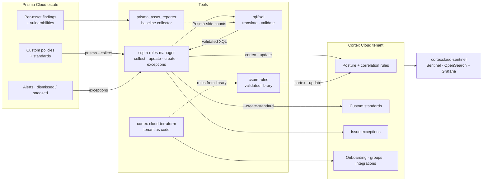

# Cortex Cloud migration and integration tooling — previews

Six tools built over several Prisma Cloud → Cortex Cloud migrations and Cortex Cloud
deployments, each with a public preview here and the source, binaries and delivery
documentation in a private repository.

> **What a preview is.** Enough to judge the tool — what it does, how it works, what it
> measured — and nothing that would let you rebuild it. Every preview has a README,
> an architecture page, a proof document with dated figures, sanitised sample output
> and an FAQ. None has source.


> **Access.** This tooling was built in the course of Palo Alto Networks Professional
> Services engagements and is made available to organisations working with me on a
> Cortex Cloud deployment or migration — see [ACCESS.md](ACCESS.md).

## The tools

| Tool | One line | Stage |
|---|---|---|
| [**rql2xql**](rql2xql-preview/) | Translates Prisma Cloud RQL policies to Cortex Cloud XQL and **validates every translation against live tenants** — populations, not counts — with every disagreement classified | 2.32.x, production on <<N>> client corpora |
| [**cspm-rules-manager**](cspm-rules-manager-preview/) | One binary to export, create, update and map Prisma policies, Cortex rules, custom compliance standards and AppSec IaC rules from reviewed workbooks; carries alert exceptions over to issue exceptions | 1.1.x |
| [**cspm-rules**](cspm-rules-preview/) | A consolidated, validated library of Cortex Cloud posture and correlation rules — the long tail of custom controls that default rule sets do not cover | 1000+ rules |
| [**cortex-cloud-terraform**](cortex-cloud-terraform-preview/) | Provisions the managed security service framework for a Cortex Cloud tenant, as code: onboarding, asset groups, standards, rules, exceptions, integrations — idempotent, with drift detection | v3.3 |
| [**prisma_asset_reporter**](prisma-asset-reporter-preview/) | Per-asset compliance findings and vulnerabilities from Prisma Cloud across 13 asset types and every cloud, at scale, exported anywhere Polars can write | v1.3 |
| [**cortexcloud-sentinel**](cortexcloud-sentinel-preview/) | Cortex Cloud in your SIEM: a Microsoft Sentinel solution (20 tables, 30 workbooks, bidirectional case playbooks) and its AWS OpenSearch + Grafana counterpart | Sentinel v7.0 · AWS v1.0 |

## How they fit together



A migration runs left to right: `prisma_asset_reporter` and `cspm-rules-manager`
capture the Prisma side; `rql2xql` translates and validates; `cspm-rules-manager`
deploys rules, standards and exceptions; `cspm-rules` adds the controls the estate
never wrote but needs; `cortex-cloud-terraform` keeps the tenant configuration under
version control from day one; `cortexcloud-sentinel` puts the result in front of the
SOC, GRC and asset owners in the SIEM they already read.

Each tool also stands alone — a Sentinel integration does not need a migration, and
the rule library deploys to a tenant that was never on Prisma.

## What "validated" means across these tools

The common thread is **measurement against live tenants, written down**. A translated
rule is accepted when its population matches Prisma's, not when its count is close. A
library rule carries the date, tenant class and population of its last validation. An
exception migration reports the tenant's creation quota because it was measured, not
assumed. Where a platform cannot express a control, the gap is documented rather than
dropped. The proof documents in each preview show the figures; the methodology is
public so the figures can be judged.

## Repository layout

```
README.md                         this page
ACCESS.md · SECURITY.md · LICENSE  shared across all previews
rql2xql-preview/
cspm-rules-manager-preview/
cspm-rules-preview/
cortex-cloud-terraform-preview/
prisma-asset-reporter-preview/
cortexcloud-sentinel-preview/
```

Each preview folder is self-contained and can be read on its own.


## About

Built and maintained by **okostine-panw**, cloud security consultant specialising in
Palo Alto Networks Cortex and Prisma Cloud across AWS, Azure, GCP and OCI. Questions,
access requests and engagement enquiries: **okostine@...** or an issue on
this repository using the *Access request* or *Question* template.

---

*Palo Alto Networks, Prisma Cloud, Cortex, Cortex Cloud, Cortex XDR and Cortex XSIAM are
trademarks of Palo Alto Networks, Inc. Microsoft Sentinel and Azure are trademarks of
Microsoft Corporation; Amazon Web Services, OpenSearch and Amazon Managed Grafana are
trademarks of Amazon.com, Inc. or its affiliates; Grafana is a trademark of Grafana
Labs; Terraform is a trademark of HashiCorp. This is not an official Palo Alto Networks
project. Figures quoted describe specific engagements at the dates given.*
