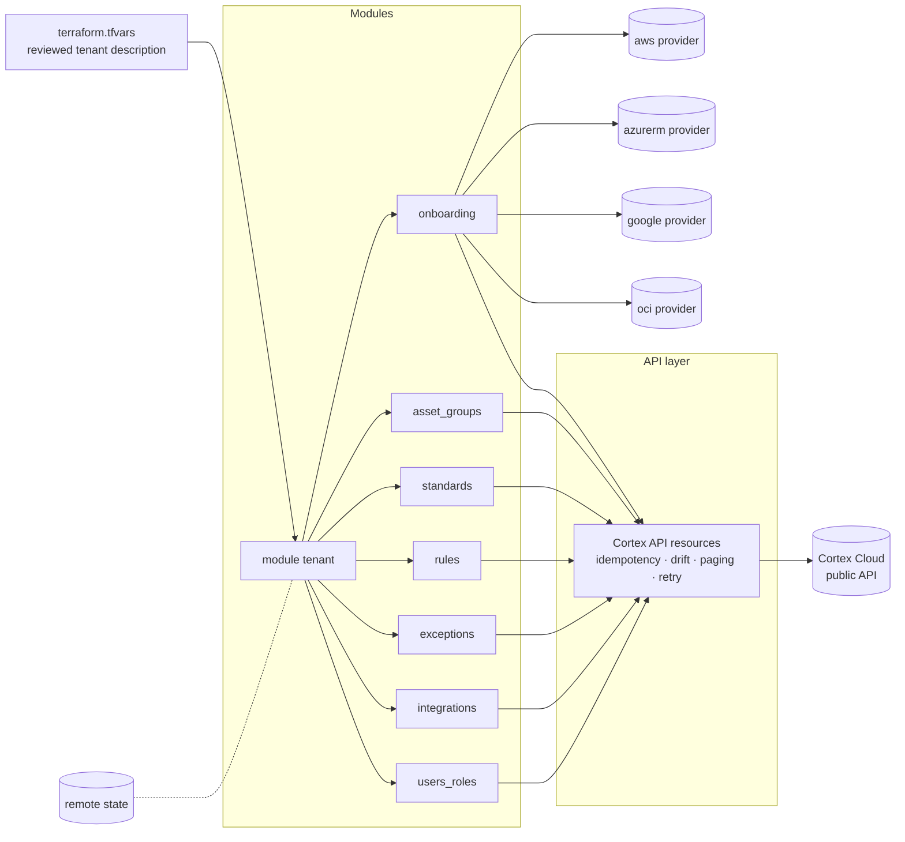

# Architecture

## The API layer

Cortex Cloud exposes tenant configuration through its public API but not through an
official Terraform provider for these objects. The modules therefore carry an API layer
that gives each object type Terraform semantics:

| Concern | Approach |
|---|---|
| Create / read / update / delete | per object type, mapped to the API's actual verbs (some objects have no update and are replaced; some have no delete and are disabled) |
| Idempotency | stable natural keys where the API has none; a read-before-write on every apply |
| Drift detection | read normalised to the tfvars shape so `plan` compares like with like (the API returns more fields than it accepts) |
| Paging and rate limits | handled inside the layer; `plan` on a large tenant is a few hundred calls |
| Ordering | explicit dependencies: onboarding before groups, standards before rule overrides, rules before exceptions |
| Secrets | marked sensitive; never in state in clear where the provider allows |

The specific API behaviours this layer encodes — which objects replace rather than
update, what the rule API accepts as a type identifier, how onboarding completion is
observed — are the accumulated findings of several deployments and are private.

## Module boundaries

Each sub-module is usable alone (e.g. `rules` on an already-onboarded tenant). The
`tenant` wrapper composes them with the right ordering and shares the API
configuration.

## State

Standard remote state. State contains tenant configuration (not credentials, where
avoidable); treat the backend with the same access control as the tenant.
