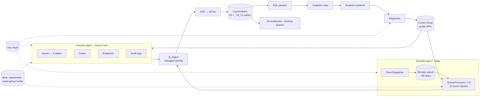

# cortexcloud-sentinel — Cortex Cloud in your SIEM: Microsoft Sentinel (Azure) and OpenSearch + Grafana (AWS)

> **Preview repository.** Architecture, data model, content catalogue, operational
> notes and cost profile for both platforms. Function code, CDK, templates, parsers,
> workbooks and dashboards are in the private repository — see
> [Getting the full tooling](#getting-the-full-tooling).

## The problem

Cortex Cloud is where cloud posture, vulnerabilities, AppSec, identity, data and AI
security findings live — but the SOC, GRC and platform teams read their SIEM. Without
an integration, Cortex issues, cases, endpoints, audit events and the asset inventory
behind them are invisible to the people who run incidents, report compliance and own
the assets. The vendor connectors that exist cover alerts; they do not carry the
inventory, the module-specific fields, the asset-group context or the dashboards the
personas need.

## What cortexcloud-sentinel does

Two deliveries of the same integration, chosen by where the customer's SIEM lives:

| | **Microsoft Sentinel** (Azure) | **OpenSearch + Grafana** (AWS) |
|---|---|---|
| Collectors | Python Azure Functions — four 5-minute timer collectors (Issues, Cases, Endpoints, Audit Logs) and a storage-queue daily inventory fan-out across 13 asset classes / ~80 categories | Six Python Lambdas on EventBridge schedules (Issues 5 min, Cases 15, Endpoints 30, Audit 30) and an SQS daily inventory fan-out (79 tasks, ≤10 workers), sharing one `cortex_common` layer |
| State | Blob watermarks and asset-group cache | DynamoDB checkpoints (monotonic conditional writes) and asset-group cache |
| Ingestion | Azure Monitor **Logs Ingestion API** (DCE + DCR, managed identity, no workspace key) | SigV4-signed OpenSearch `_bulk`; IAM only, no users or passwords |
| Data model | 20 custom tables (`*_V5_CL`): 7 alert/operations, 13 inventory; flattened "V5" schema | Same 20 entities as `cortexcloud-*-v5` indices, same field names |
| Content | 10 KQL parser functions, 3 analytics rules, 8 hunting queries, 4 Logic App playbooks (bidirectional case sync), **30 workbooks** | **30 Grafana dashboards** (six global filter variables), 3 alert rules, 8 hunting-query library panels, on Amazon Managed Grafana |
| Deployment | ARM templates + CLI scripts, step-by-step guide | One CDK (Python) app, four stacks, 15–25 min |
| Status | **v7.0, production** (Sep 2026) | **v1.0** (Jun 2026) at parity with the Sentinel v6.0 data model; dashboards converted, live verification in progress |

Shared across both: issues routed by detection method into **four tables** (general,
Vulnerability, AppSec, XDR) each with its own fields and SLA-debt calculation; module
field extraction (DSPM, CIEM, AISPM, CAS, ASM, API Security); every record enriched at
ingest with **asset-group membership**, an `IsPriorityAsset` flag and a **deep link**
back to the Cortex console; watermarked incremental collection.

## Results

<!-- Dated, no client names. -->

| Measure | Sentinel | AWS |
|---|---|---|
| Tables / indices populated | 20 | 20 |
| Workbooks / dashboards | 30 workbooks (11 persona, 13 inventory + summary, issues & ops) | 30 converted, <<N>> verified on live data |
| Inventory per daily run | 10 k – 200 k assets, ~80 parallel queue tasks | same, 79 SQS tasks, ≤10 workers |
| Alert-stream latency | ≤ 5 min | ≤ 5 min (issues) |
| Deploy from empty subscription / account | <<N>> min with the guide and scripts | 15–25 min, `cdk deploy --all` |
| Ingestion volume | ~1 – 25 GB / month by estate size | same documents; one `r6g.large` + 100 GiB covers a small estate |

## Data flow (Sentinel)

The AWS flow is the same shape with Lambda + EventBridge, SQS, DynamoDB, Secrets
Manager, OpenSearch and Amazon Managed Grafana in the corresponding places — diagram
and component mapping in [docs/AWS-OPENSEARCH.md](docs/AWS-OPENSEARCH.md).

## What is in this repository

| Path | Contents |
|---|---|
| [docs/AZURE-SENTINEL.md](docs/AZURE-SENTINEL.md) | The Sentinel solution: components, tables, routing, enrichment, ingestion path, settings |
| [docs/AWS-OPENSEARCH.md](docs/AWS-OPENSEARCH.md) | The AWS solution: Lambdas and layer, checkpoints, indices, CDK stacks, Sentinel ↔ AWS mapping, status |
| [docs/CONTENT.md](docs/CONTENT.md) | Catalogue: 30 workbooks by persona, parsers, analytics rules, hunting queries, playbooks |
| [docs/NOTES.md](docs/NOTES.md) | Operational findings on both platforms that are not in the vendor docs |
| [docs/COST.md](docs/COST.md) | Ingestion and storage cost by estate size, both platforms |
| [docs/FAQ.md](docs/FAQ.md) | Scope, limits, upgrade path |
| [docs/img/](docs/img/) | Workbook and dashboard screenshots (lab tenant) |
| [ACCESS.md](../ACCESS.md) | How to get the solution |

## What is **not** in this repository

Function and Lambda code and the shared layer, the ingestion sender and column map,
ARM templates and deploy scripts, the CDK app, DCR generator and schema snapshots,
parser and workbook JSON, Grafana dashboard / alert / library-panel JSON and the
import script, analytics rules, playbooks, the deployment guides and test plans.

---

## Getting the full tooling

This tooling was built in the course of Palo Alto Networks Professional Services
engagements and is made available to organisations working with me on a Cortex Cloud
deployment or migration. See [ACCESS.md](../ACCESS.md).

## Related previews

| Repo | What it is |
|---|---|
| [rql2xql-preview](https://github.com/neocortex-security/cortex-security-automation/tree/main/rql2xql-preview) | Prisma Cloud RQL → Cortex Cloud XQL translator with live validation |
| [cspm-rules-manager-preview](https://github.com/neocortex-security/cortex-security-automation/tree/main/cspm-rules-manager-preview) | One CLI to collect, update and create Prisma policies, Cortex rules and AppSec rules |
| [cspm-rules-preview](https://github.com/neocortex-security/cortex-security-automation/tree/main/cspm-rules-preview) | Consolidated, validated CSPM rule library for Cortex Cloud |
| [cortex-cloud-terraform-preview](https://github.com/neocortex-security/cortex-security-automation/tree/main/cortex-cloud-terraform-preview) | Cortex Cloud tenant provisioning as code |
| [prisma-asset-reporter-preview](https://github.com/neocortex-security/cortex-security-automation/tree/main/prisma-asset-reporter-preview) | Per-asset compliance findings and vulnerabilities from Prisma Cloud, cross-cloud, by asset type or custom RQL |
| [cortexcloud-sentinel-preview](https://github.com/neocortex-security/cortex-security-automation/tree/main/cortexcloud-sentinel-preview) | Microsoft Sentinel → AWS (OpenSearch + Grafana) data pipeline |

---

*Palo Alto Networks, Prisma Cloud, Cortex, Cortex Cloud, Cortex XDR and Cortex XSIAM are
trademarks of Palo Alto Networks, Inc. This is not an official Palo Alto Networks project.
Figures quoted describe specific engagements at the dates given.*
