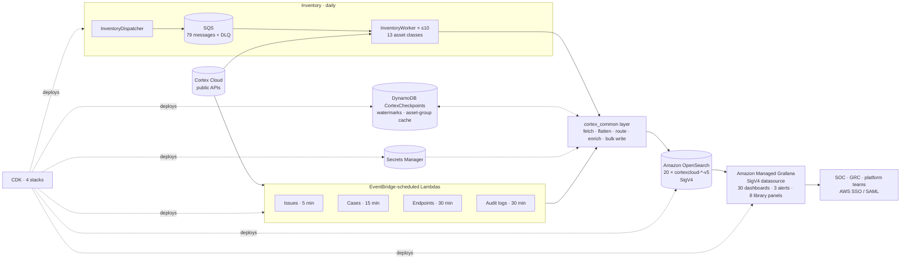

# AWS solution (v1.0) — Lambda, OpenSearch, Amazon Managed Grafana

For customers whose security data platform is on AWS. The same integration as the
Sentinel solution — same collectors, same V5 data model and field names, same 20
entities, same dashboards — built from AWS-native parts and deployed as one CDK
(Python) application. Released June 2026 at parity with the Sentinel solution's
v6.0 data model.



## Components

| Component | What it is |
|---|---|
| **Scheduled ingestors** | Four Lambdas on EventBridge schedules: Issues (5 min, routed to four indices by detection method), Cases (15 min), Endpoints (30 min), Audit Logs (30 min). Safety stop at 540 s |
| **Inventory fan-out** | `InventoryDispatcher` (daily) enqueues one SQS message per asset class × category (79); `InventoryWorker` (batch size 1, reserved concurrency 10, DLQ after 3 retries) processes one class/category each — fetch, flatten, promote module fields, resolve asset groups, bulk write. Safety stop at 570 s |
| **`cortex_common` Lambda layer** | Shared by all six functions: API client (auth headers, FQDN normalisation, payload builder), transformer (flattening, timestamps, module-field promotion), issue routing + `RiskSLADebt`, asset-group cache, checkpoint store, SigV4 OpenSearch bulk writer, Secrets Manager accessor with warm-container caching, async paginator with deadline and 429 back-off |
| **Checkpoints** | DynamoDB table (on-demand, PITR): per-stream watermarks written with a **monotonic conditional write**, and the asset-group name cache with delta refresh |
| **Store** | Amazon OpenSearch Service; one index per entity, `cortexcloud-<entity>-v5`; SigV4 for Lambdas and Grafana, no users/passwords; fine-grained access control |
| **Visualisation** | Amazon Managed Grafana (AWS SSO or SAML), OpenSearch datasource over SigV4, 30 dashboards with six global filter variables (`$priority`, `$provider`, `$account`, `$region`, `$bizapp`, `$assetgroup`) and a time picker; 3 alert rules; 8 hunting-query library panels |
| **CDK** | `CortexDataStack` (OpenSearch domain, DynamoDB), `CortexSecretsStack` (Secrets Manager), `CortexIngestionStack` (layer, 6 Lambdas, 5 schedules, SQS + DLQ, per-Lambda least-privilege roles), `CortexGrafanaStack` (workspace, read-only OpenSearch role) |

## Indices (20)

**Core (scheduled):** `cortexcloud-issues-v5` · `-vuln-issues-v5` · `-appsec-issues-v5` ·
`-xdr-issues-v5` · `-cases-v5` · `-endpoints-v5` · `-audit-logs-v5`

**Inventory (daily):** `cortexcloud-<class>-inventory-v5` for Compute, Identity, Network,
Data, Security Services, Application, AI, Code, API, External Surface, Organization,
Management, Other.

Field names are the Sentinel solution's, minus the Log Analytics type suffixes, so a
dashboard ported from a workbook reads the same fields.

## Sentinel ↔ AWS mapping

| Sentinel solution | AWS solution |
|---|---|
| Azure Functions, timer trigger | Lambda + EventBridge Scheduler |
| Storage queue + queue-triggered function | SQS (+ DLQ) + SQS-triggered Lambda |
| Blob watermarks and asset-group cache | DynamoDB `CortexCheckpoints` |
| Key Vault | Secrets Manager |
| Logs Ingestion API (DCE / DCR) → `_V5_CL` tables | SigV4 `_bulk` → `cortexcloud-*-v5` indices |
| ARM templates + CLI scripts | CDK (Python), four stacks |
| Workbooks | Grafana dashboards |
| Analytics rules → incidents | Grafana alert rules |
| Hunting queries | Grafana library panels |
| Logic App playbooks (case write-back) | <<not yet — state plan>> |

## Configuration

All tunables are CDK context (`cdk.json`, overridable with `--context`): the five
schedules, first-run lookback, inventory lookback days, the `RiskSLADebt` windows and
penalties, priority asset groups, bulk batch sizes, runtime limits, worker concurrency.
Changing a schedule is a one-stack redeploy.

## Deployment

```
cdk bootstrap aws://<account>/<region> --app "python3 infra/app.py"
cdk deploy --all --app "python3 infra/app.py" --context aws_account=… --context aws_region=…
```

Four stacks in dependency order, 15–25 minutes (OpenSearch domain creation dominates);
then replace the placeholder secrets, map the Lambda roles into OpenSearch fine-grained
access control, add the Grafana datasource, import dashboards / library panels /
alerts (API-driven import script included), trigger the inventory dispatcher once.
The deployment guide covers a deployer IAM user, the master-user recovery path, a
signed proxy for OpenSearch Dashboards, and verification scripts.

## Status

Data pipeline: all 20 indices populated on the reference deployment. Dashboards: all
30 converted from the workbooks; <<N>> verified against live data, the remainder under
repair after the OpenSearch datasource change — see CONTENT.md for per-dashboard
status. Case write-back (the Sentinel playbooks) has no AWS equivalent yet.
