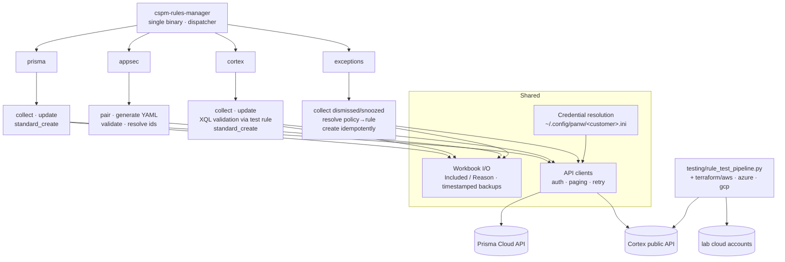

# Architecture

## Design points

- **One binary, four subcommands.** Earlier there were three repos and three scripts
  (Prisma manager, Cortex manager, IaC manager) sharing most of their code and all of
  their config; they were merged in October 2026 and the exceptions subcommand added
  in November. The translator stays a separate binary because its release cadence is
  different. The test pipeline stays a script because it needs Terraform and the cloud
  CLIs beside it.
- **Workbook as the review surface.** Every write to a tenant reads from a workbook
  whose `Included` column a human has set; the tool answers per row in `Reason` and
  backs the file up before rewriting it. There is no "update everything" mode and no
  bulk delete.
- **XQL validated before deployment.** On the Cortex side every rule body is run
  through a dedicated validation rule on the tenant before a production rule is
  created or patched. The validation rule id is mandatory in the config; a tenant
  without one fails closed.
- **Credentials out of band.** One INI per customer holding both tenants, outside any
  repository; never logged, never on the command line.
- **Idempotent by construction.** Re-running a collect-then-update cycle changes
  nothing the second time; exceptions carry a deterministic external id and are
  searched for before being created; standards reuse existing controls by name.

## Findings encoded in the tool

These are the behaviours that are not in the vendor documentation and that the tool
exists to handle. Stated here at the level a user needs; the handling is private.

| Area | Finding | What the tool does |
|---|---|---|
| Cortex compliance standards | Two compliance APIs coexist: a hierarchical one whose standards are invisible to the other and cannot be mapped to rules, and a flat one (controls with category / subcategory) that rules map to but which cannot create new categories | Uses the flat API so created standards are usable for rule mapping; matches template rows to existing categories; names controls so the same text appears on both platforms |
| Cortex rule creation | The rule API accepts a narrower set of asset-type identifiers than the dataset exposes, and some constructs are refused at creation despite running as queries | Validates through the test rule first; reports refusals per row with the API reason |
| Issue exceptions | A default tenant quota of roughly 10 exception creations per rolling 24 h (measured, not per calendar day); some resource types are excluded; renamed policies need fuzzy name matching | Computes when the window reopens from timestamps in the workbook and how many runs remain; chunks assets per exception; `--strip-prefix` and name-map for renamed policies; recommends raising the quota with the tenant administrator before migration day |
| Prisma policy export | Custom policies, saved searches and standard mappings live behind separate calls with different paging | One collect produces one row per policy with everything a review needs |

## What is public vs private

| Layer | Public |
|---|---|
| CLI surface, flags, menu, exit behaviour | yes (USAGE.md) |
| Workbook convention (`Included` / `Reason`, backups, file names) | yes |
| Credentials file layout | yes |
| The findings above, at user level | yes |
| API client code, request shapes, identifier maps, the handling of each finding | no |
| Subcommand implementations | no |
| Terraform test fixtures | no |
| Binaries, installation guides, migration guides | licensed users |
