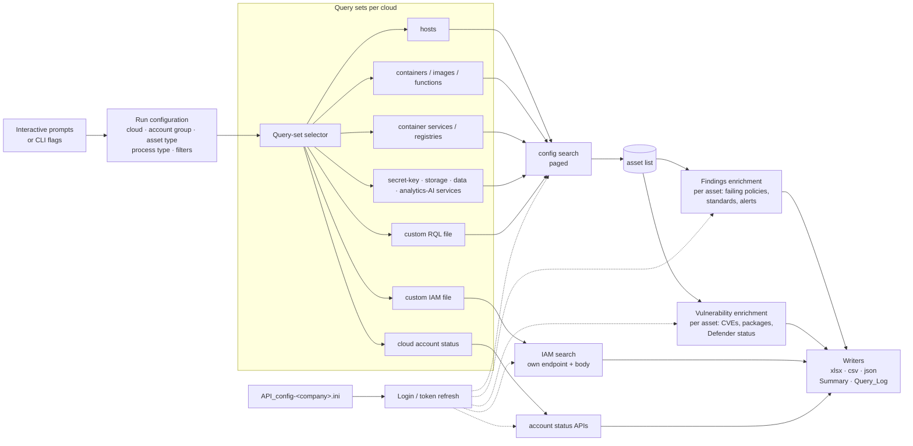

# Architecture



## Flow of a run

1. **Configure** — prompts with defaults, or flags for scheduled use. The summary is
   printed and logged before any API call.
2. **Login** — per-company INI (`API_config-<company>.ini`) selects the Prisma stack
   and credentials; token refreshed before expiry; customer name and Prisma id echoed
   so the operator can see they are on the right tenant.
3. **Select query set** — the asset type maps to a curated set of RQL queries, one or
   more per cloud, restricted to the chosen cloud(s) and account group. Custom modes
   read the query files instead.
4. **Enumerate assets** — configuration search, paged to completion, with the asset
   name and tag filters applied (server-side where the API supports it, client-side
   otherwise). *Process only filtered* short-circuits enrichment to the matched set.
5. **Enrich** — per asset, in bounded concurrency:
   - **findings**: failing policies with severity, standard mappings and alert
     linkage;
   - **vulnerabilities**: CVEs and, unless CSPM-only, runtime package inventory and
     Defender status (hosts, images, functions).
6. **Write** — one workbook with the sheets in REPORTS.md, plus CSV/JSON.

## Why curated query sets

"Storage services" is not one API name; it is a dozen across the clouds, each with a
different shape. The query sets encode which API names constitute each service class
per cloud and which fields identify the asset, so that one run gives a normalised
cross-cloud table. Maintaining those sets as Prisma adds API names is ongoing work and
is the private part of the tool, together with the IAM and vulnerability request
shapes.

## Concurrency model

```
enumerate ──► queue ──► [findings workers × Nf] ──► frame
                   └──► [vuln workers × Nv] ──► [package workers × Np] ──► frame
```

- Asset enumeration pages are released to the enrichment queues as they arrive; the
  tool does not wait for the full asset list before starting enrichment.
- Each endpoint family has its own concurrency ceiling (`Nf`, `Nv`, `Np`) and its own
  back-off state, so a rate-limited vulnerability endpoint slows only the vulnerability
  workers.
- 429 / 5xx: exponential back-off with jitter; a worker that exhausts retries records
  the asset in an `Errors` sheet rather than failing the run.
- Token refresh is shared and lock-protected so a refresh does not stampede.
- Throughput is therefore set by the tenant's per-endpoint limits. On the reference
  runs the tool sustains <<N>> API calls/s aggregate; see the README results table.

## Data layer — Polars

Every API response is normalised into a Polars frame per entity (assets, findings,
vulnerabilities, packages, accounts). Joins (asset ⇄ findings ⇄ vulnerabilities),
severity roll-ups, pivots and the `Summary` sheet are Polars expressions, which keeps
a multi-million-row run in memory on a laptop and makes the output step a single
write per destination.

**Export.** The frames are written to whatever Polars can write to, selected by flag:

| Target | Mechanism |
|---|---|
| XLSX (default, for people) | `write_excel`, one sheet per frame, styling applied |
| CSV / NDJSON / JSON | native writers |
| Parquet / Arrow IPC / Avro | native writers; Parquet partitioned by cloud / account / date on request |
| S3 · Azure Blob / ADLS · GCS | cloud URIs with storage options — written straight to the bucket, no local copy |
| Delta Lake | `write_delta`, append or overwrite per run |
| Databases (PostgreSQL, SQL Server, Snowflake, BigQuery, DuckDB, SQLite, …) | `write_database` via SQLAlchemy or ADBC |
| In-process hand-off | Arrow interchange to pandas / DuckDB / Spark |

Several targets can be given for one run (workbook for the asset owner, Parquet to the
lake, rows to the reporting database).

## Client behaviour

| Concern | Behaviour |
|---|---|
| Paging | per endpoint style; always to completion |
| Identifiers | Prisma RRN / unified asset id as the join key across frames |
| Memory | Polars frames; lazy/streaming mode for the largest runs |
| Audit | `Query_Log` records every query, scope, rows, duration; `Errors` records any asset that could not be enriched |

## Runtime

Python, run with `uv` from source or as a single binary per platform. No database
required; output goes wherever you point it.
