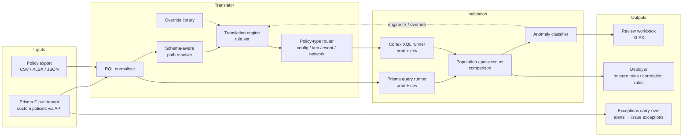

# Architecture

## Components

| Component | Role | Public? |
|---|---|---|
| RQL normaliser | Canonical form of the RQL text; the key for overrides and caching | no |
| Schema catalogue | Collected raw-field layout per asset type (not vendor documentation); drives path resolution and casing | no |
| Translation engine | Versioned rule set; each rule carries the measurement that justified it | no |
| Override library | Hand-written XQL keyed by normalised RQL, each with counts and date | no |
| Policy-type router | Chooses posture rule vs correlation rule and the source dataset | described here |
| Query runners | Async, rate-limited, retry on tenant concurrency limits; prod and dev in one pass | no |
| Comparison | Set difference on resource identifiers where available, else per-account counts | described in METHODOLOGY |
| Anomaly classifier | Assigns one of the named classes to each disagreement | classes public, rules private |
| Review workbook | Per-batch XLSX for client and engineering review | sample public |
| Deployer | Creates / updates rules through the Cortex public API | no |

## Runtime

- Python, distributed as a single binary per platform (macOS arm64, Linux x86_64); no
  Python install needed on the operator's machine.
- Credentials: per-tenant config files outside the repository; never on the command
  line.
- A full validation pass over ~500 policies against two Prisma and two Cortex tenants
  completes in <<N>> minutes, bounded by tenant query concurrency limits.

## Data handling

- Policy text and query results stay on the operator's machine; nothing is sent
  anywhere except the two vendor APIs.
- Review workbooks contain resource identifiers from the client's tenants and are
  treated as client data.
